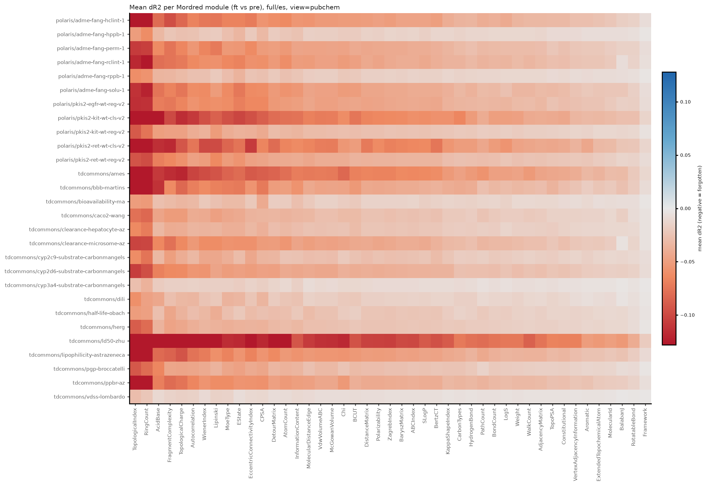
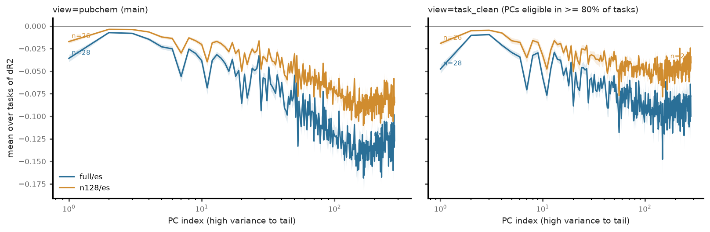
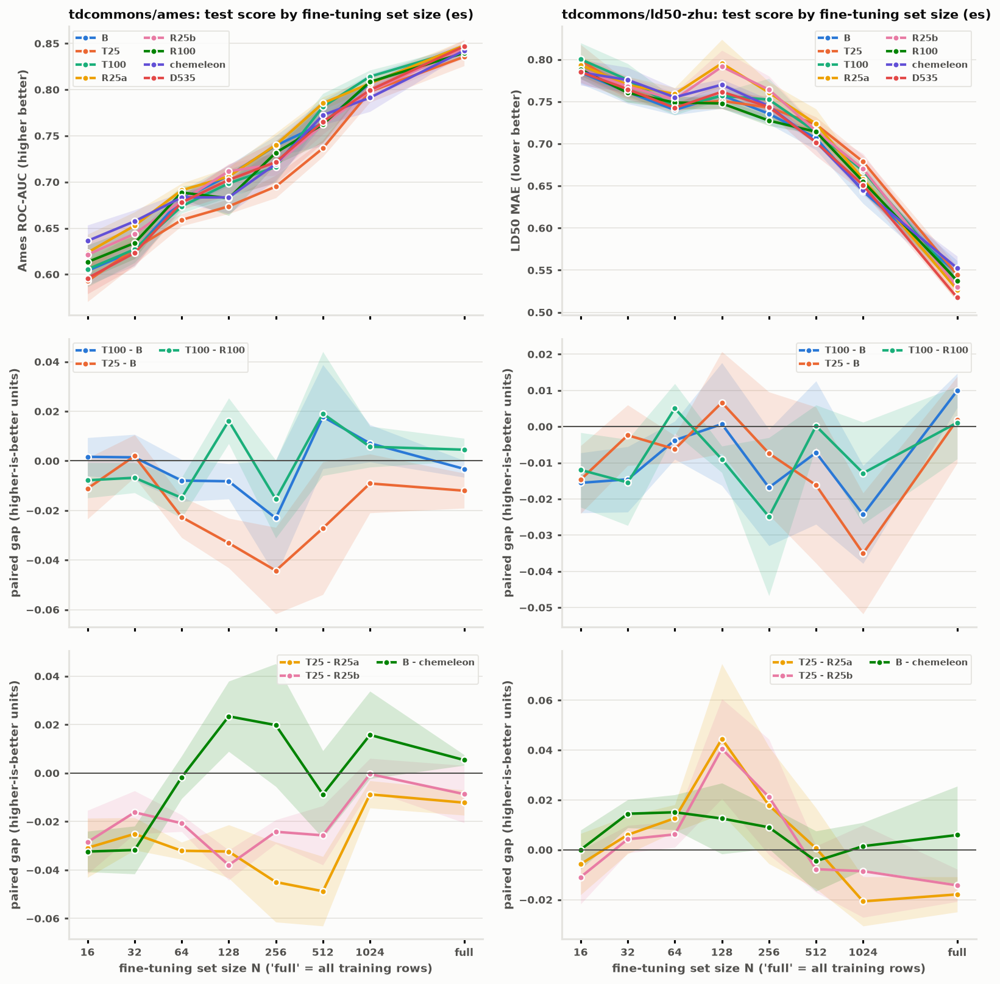

# Does fine-tuning *unlearn* descriptor pretraining — and would task-tailored descriptor targets give better low-data models?

A two-phase study on [CheMeleon](https://github.com/JacksonBurns/CheMeleon), a Chemprop
D-MPNN pretrained to predict 1613 Mordred descriptors on ~1M PubChem molecules, using the 28
Polaris/TDC benchmarks from the CheMeleon paper. Everything here — design docs, plans, code,
build ledgers with every decision, and results — is in this repository.

**Short version.** Fine-tuning does erode some of what pretraining taught (phase 1), but what
is erased is mostly the same for every task, and *which* descriptors the encoder was
pretrained to predict makes no detectable difference to downstream performance at any
training-set size (phase 2). 25 randomly chosen real descriptors pretrain an encoder as good
as all 1613; a 200k-molecule, one-GPU, one-hour run matches the public 1M-molecule model.
The "task-tailored descriptor targets" idea is closed; the positive by-product is a very cheap
pretraining recipe and the finding that the pretraining *target set* is not a lever.

### Results at a glance

| question | answer | evidence |
|---|---|---|
| Does fine-tuning unlearn what pretraining taught? | Partly: ~16% of pretraining-added descriptor information becomes unrecoverable at full data, ~8% at 128 molecules | phase 1, 28 tasks × 3 seeds, exact ridge probe |
| Is what is unlearned task-specific? | Mostly not: 80% of the forgetting pattern is shared across tasks; nothing becomes *more* recoverable | cross-task Spearman 0.81; positive control fails everywhere |
| Does pretraining on task-tailored targets help low-data fine-tuning? | No detectable effect at any N; 25 tailored targets are slightly *worse* than 25 random ones on Ames | phase 2, pre-registered endpoint 0/3 points, both tasks |
| Does the target set matter at all? | Not detectably: 25 random real descriptors ≈ 100 tailored ≈ 1613 ≈ public CheMeleon | eight arms within ~0.03 at every N |
| Does pretraining matter at all? | Yes, from N ≈ 32 upward (+0.07 AUC / +0.05 MAE vs a never-pretrained encoder) | `rand` arm |
| Can CheMeleon be re-pretrained cheaply? | Yes: 200k molecules, one RTX 4090, ~1 hour, matches the public 1M model downstream | B vs chemeleon ≈ 0 |

### If you have ten minutes

1. Read §1 (the hypothesis) and the two premises.
2. Look at the phase-1 heatmap in §2: the structure is in the *columns* (descriptor
   families), not the *rows* (tasks) — every task forgets the same things.
3. Look at the phase-2 ladder figure in §3: eight pretrained encoders, one bundle of curves.
4. Read "Why the feature-level selector did not transfer" in §3.
5. §4 for what we keep and where this points.

---

## 1. The hypothesis

CheMeleon's pretraining target is enormous and redundant: 1613 descriptors, of which 606 are
autocorrelations and two correlation clusters alone are "molecular size". The hypothesis:

> Pretraining bakes in information that is irrelevant or harmful for a given downstream
> task. Fine-tuning must *unlearn* it, and with little data there is not enough signal to do
> so. Pretraining on a **task-tailored descriptor set** should therefore give better models,
> with the advantage largest in the low- and ultra-low-data regime.

Two testable premises follow, and each phase tests one:

1. **Phase 1 — does fine-tuning actually unlearn, and is what it unlearns task-specific?**
   If the encoder barely moves, or if every task forgets the same things, there is nothing to
   tailor.
2. **Phase 2 — does pretraining on a tailored target set help, especially at low N?**
   With the proper controls: all 1613, a size-matched *random* set, a never-pretrained
   encoder, and the public model.

Terminology used throughout: *targets* are the descriptor columns an encoder is pretrained to
predict; the *featurizer* is the atom/bond input encoding of the graph (Chemprop V2 multi-hot
in every model here). Only targets were varied.

---

## 2. Phase 1 — encoder-drift check

**Design:** `docs/specs/2026-10-22-encoder-drift-check-design.md` · **Findings:**
`docs/results/2026-10-22-drift-findings.md` · tables/figures: `docs/results/summary/`

### Pipeline

```
Polaris 28 tasks ──► fine-tune CheMeleon ──► 324 encoders ──► linear probe for 1613 descriptors ──► drift measures
  (cached once)      full data | 128 mols       (es, last)      on 10k held-out PubChem molecules      CKA, ΔR² per descriptor,
                     fine-tuned | frozen         + test preds    + each task's own molecules            drop calls, η² family test,
                     3 seeds, paper protocol                     (exact ridge, paired bootstrap)        PCA view, novel/seen views
```

- **Fine-tuning** reproduces the paper's protocol (astartes 80/20 split, 256-hidden head,
  50 epochs, patience-5 early stopping). Each run keeps the early-stopped (`es`) and
  epoch-50 (`last`) encoder. A frozen-encoder variant tells whether moving the encoder helps.
  Test scores land within 1 SD of the paper's 5-seed range in 77/84 runs.
- **Probing.** For every encoder (pretrained, 3 random, each fine-tuned one) the same exact
  ridge probe maps the 2048-d embedding to each descriptor. R² is measured on 2k PubChem
  molecules CheMeleon never trained on, and out-of-fold on each task's own training
  molecules (restricted to rows the fine-tuned model never took gradient steps on). The
  random-weight encoder marks the floor (median R² 0.59 — a D-MPNN recovers many descriptors
  with no training at all), the pretrained one the ceiling (0.94); differences are read as
  a fraction of that gap.
- **Statistics.** Paired bootstrap (pretrained vs fine-tuned on identical resampled rows); a
  descriptor is "dropped" if ΔR² < 0 in all 3 seeds, below −3 SE and below −0.05; descriptor
  families via Mordred module and |ρ| ≥ 0.9 correlation clusters (535 of them); a PCA view to
  avoid double-counting; pretraining-overlap views (35% of task molecules were in CheMeleon's
  pretraining set).

### Results

| | Full data | 128 molecules |
|---|---|---|
| CKA vs pretrained (PubChem / task molecules) | 0.85 / 0.74 | 0.88 / 0.76 |
| Median descriptor ΔR² | −0.04 | −0.02 |
| Descriptors "dropped" | 25–32% | 6–12% |
| Share of pretraining-added information lost | **~16%** | ~8% |

- **What is lost is ~80% the same across tasks** (cross-task Spearman 0.81 vs 0.95 between
  seeds of one task). A reproducible task-specific component explains ~18% of the variance.
- **Nothing improves.** At most 2 descriptors per task become more recoverable; the
  label-correlated descriptors lose R² like everything else.
- **Loss sits in the fine detail**: PCs 1–10 lose 0.03, the tail loses 0.13; most eroded
  families are the ones pretraining taught most (ring counts, topological charge,
  autocorrelations).
- The descriptors fine-tuning generically *preserves* are the least task-relevant ones.



*Mean ΔR² per Mordred module after full-data fine-tuning (red = forgotten), one row per task.
The pattern is a property of the descriptor families, not of the task: topological indices and
ring counts erode everywhere; simple counts barely move. Tasks differ in **how much** they
drift (LD50, Ames, lipophilicity most), not in **what** they drop.*



*Loss by principal component of the descriptor space: the high-variance directions (size,
composition) are nearly intact; the fine detail in the tail is where fine-tuning spends its
budget — and it does so far less with 128 molecules.*

Read for the hypothesis: fine-tuning erodes pretraining detail, generically; at 128
molecules it barely moves the encoder. That was a warning sign for "tailoring", but not a
refutation — so phase 2 tested it directly.

---

## 3. Phase 2 — tailored-target pretraining

**Design:** `docs/specs/2026-10-22-phase2-tailored-pretraining-design.md` · **Findings:**
`docs/results/2026-10-23-phase2-findings.md` · tables/figures: `docs/results/phase2/`

### Choosing the tailored set

Phase 1's "what gets forgotten" signal was too unstable to define a set (Jaccard 0.15–0.6
across checkpoints/views), so the tailored set uses **label relevance at cluster level**:
rank the 535 correlation clusters by how well their members predict the Ames and LD50
training labels (CV AUC / R²), keep the top k clusters, one representative descriptor each.
A shallow-FFN check confirmed the sets *carry* the task information (100 tailored
descriptors beat all 1613 as input features on LD50). Demo tasks: Ames mutagenicity and LD50
acute toxicity — the most similar pair in phase 1 with only 22% shared molecules.

### Arms (one pipeline; only the target set differs)

| arm | targets | arm | targets |
|---|---|---|---|
| **B** | all 1613 | **R100 / R25a / R25b** | size-matched random real descriptors |
| **T100 / T25** | tailored, top-100 / top-25 clusters | **D535** | one representative per cluster (dedup only) |
| **chemeleon** | public weights (reference) | **rand** | random-init encoder, no pretraining |

Pretraining: CheMeleon's published Zenodo descriptors (not recomputed), 200k PubChem
molecules with the Ames/LD50 test molecules removed, D-MPNN 2048×6, masked-dropout MSE,
one-cycle LR, patience 15, one RTX 4090 per arm (35–90 min each). Second pretraining seeds
for B and T100 estimate pretraining variance.

### Downsampling ladder

N ∈ {16, 32, 64, 128, 256, 512, 1024, full}; 10/10/10/5/5/3/3/3 seeds; **one subsample per
(task, N, seed) shared by every arm** (paired comparison; Ames stratified). N ≤ 64: fixed 16
optimizer steps, batch min(N, 16). N ≥ 128: the paper protocol. Scored on the untouched
Polaris test sets. Pre-registered endpoint: T100 − B at N ∈ {16, 32, 64}, success = better
by more than the paired SD at ≥ 2 of 3 points in both tasks with the gap shrinking as N grows.

### Results



*Top: test score vs fine-tuning set size for every arm (mean ± SE over paired subsamples).
Below: paired gaps for the contrasts that matter, with the zero line. A real tailoring
effect would show as T100 − B above zero and shrinking with N; it does neither.*

| task | T100 − B at N=16/32/64 (gap > SD?) | Spearman(gap, N) | verdict |
|---|---|---|---|
| Ames (ROC-AUC) | 0 / 3 | +0.12 | not met |
| LD50 (MAE) | 0 / 3 | +0.14 | not met |

- **Tailored ≈ all ≈ random.** T100 − B, T100 − R100 and B − chemeleon are all within noise
  at every N. T25 is *worse* than both random-25 draws on Ames (−0.02 to −0.03 AUC) and ≈ equal
  on LD50. With 10 paired seeds the detectable effect is ~0.02; smaller effects are not excluded.
- **Pretraining itself is detectable** — the never-pretrained encoder is clearly worse from
  N = 32–64 upward (+0.07 AUC / +0.05 MAE at N = 64–128) — so "all pretrained arms are equal"
  is a statement about encoders that *do* differ from no pretraining.
- **Pretraining-seed variance is small** (|B_s1 − B|, |T100_s1 − T100| ≤ 0.015), the same scale
  as the tailored − all gap.
- **200k molecules ≈ 1M.** Our B matches public CheMeleon across the ladder (|gap| ≤ 0.03;
  N=full scores reproduce phase 1 within 0.01 on 5 of 6 seeds). The one pretraining-side effect
  seen: public CheMeleon beats our B by +0.03 on Ames at N = 16–32, where B ≈ random-init.
- One lead: deduplicated targets (D535) give the best LD50 at full data (MAE 0.517 ± 0.007 vs
  0.546 ± 0.026) — untested further.

**Why the feature-level selector did not transfer.** Descriptor relevance *as an input
feature* and value *as a supervision signal* are different properties. Mordred is so
redundant that any 25 real descriptors already demand the same general chemistry from the
encoder; once it computes that, the task head finds what it needs during fine-tuning
regardless of which targets were used.

**Independent corroboration.** OpenADMET's
[*Throwing Everything AND the Kitchen Sink at CheMeleon*](https://openadmet.ghost.io/throwing-everything-and-the-kitchen-sink-at-chemeleon/)
(Aug 2026) swept 15 target sets at full data and found CheMeleon "robust to pre-training
methodologies"; their positive signals were *relevant molecules* (a 40k analog set beat a
10M diverse pool) and *property-like targets* (surrogate ADMET predictions, ~6%).

### Still running (results appended when scored)

- Frozen-encoder ladder (B, T100, R100, chemeleon) — with the encoder frozen nothing can be
  unlearned, the most direct test of the mechanism; 64-step small-N budget.
- **Full-pool rescue:** T100 and B pretrained on the full ~941k-molecule pool (T100_full,
  B_full), targeting the one regime where pool size showed an effect.

---

## 4. What the project keeps, and what's next

- A reproducible CheMeleon-style pretraining recipe: 200k molecules, 25–1613 targets,
  ~1 GPU-hour, matching the public model downstream.
- A paired downsampling-ladder harness with a pre-registered endpoint, and phase-1 probing
  tools (exact ridge probe, paired bootstrap, drift measures).
- Next direction: a **CheMeleon-lite** (fast to pretrain, small, little fine-tuning), with
  the levers the evidence points to — use the descriptor head at fine-tuning, better
  estimators on frozen embeddings, task-relevant *molecules* and *property-like* targets.

---

## 5. Questions colleagues have asked

**"Random descriptors? You mean random numbers?"** No. R25/R100 are real Mordred descriptors
chosen at random from the 535 cluster representatives — real chemistry, just not chosen for the
task. The never-pretrained encoder is a separate arm (`rand`), and it *is* worse.

**"Isn't the FFN sanity check already the answer?"** It showed the tailored descriptors carry
the task's information *as input features*. Phase 2 shows that is not the same as being a
better *pretraining target*: any handful of real descriptors already forces the encoder to
learn the same general chemistry.

**"How do you know the ladder could detect anything?"** The never-pretrained arm is clearly
worse from N ≈ 32 (+0.07 AUC at N = 64–128); pretraining-seed replicates differ by ≤ 0.015; and
the paired design puts every arm on the identical molecules at every (N, seed). Effects below
~0.02 are not excluded — that is the detectable size with 10 seeds.

**"Why only two tasks in phase 2?"** Pretraining is the expensive step. Ames and LD50 were the
phase-1 pair with the most similar task-specific drift *and* only 22% shared molecules, so a
shared "tox-tailored" set was the fairest test. OpenADMET's independent 15-target sweep covers
the breadth.

**"Why 16 optimizer steps at N ≤ 64?"** The paper protocol early-stops on a validation split,
which at N = 16 would be three molecules. Sixteen steps with batch min(N, 16) is roughly where
phase-1's best 128-molecule checkpoints sat; it is the same for every arm.

**"What about the 58 descriptors that differ between the Zenodo targets and our recompute?"**
RDKit/mordred version drift in the original run (worst: nHBAcc). We pretrain on the published
values — they are CheMeleon's actual targets — and record the affected columns.

### Compute and timeline

Phase 1: 324 fine-tunes (~10 GPU-h) + probing (~3 h on CPU/GPU). Phase 2: 12 pretraining runs
(~11 GPU-h), 1078 ladder fine-tunes (~3 GPU-h), Mordred descriptors reused from Zenodo. All on
two RTX 4090s over two days; every stage is resumable and scripted.

### Decision log

Every judgment call made while building — probe regularization, what counts as "dropped",
patience 5 → 15 after a training-length confound, the pretraining-overlap decision, the
Zenodo-vs-recompute mismatch, and the controls added after review — is recorded with its
rationale and its cost-if-wrong in the build ledgers:
`docs/results/2026-10-22-phase1-build-ledger.md`, `docs/results/2026-10-23-phase2-build-ledger.md`.

---

## 6. Repository map

```
docs/specs/      design documents (phase 1, phase 2) — the authority each plan argues from
docs/plans/      implementation plans (task by task)
docs/results/    findings notes, summary tables and figures, build ledgers with every ruling
src/drift/       package: tasks, encoders, finetune, descriptors, probe, stats, measure, score, summarize
src/drift/phase2 sets, pool, pretrain_data, pretrain, ladder, analysis
scripts/         numbered pipeline stages: 00–06 (phase 1), p2_00–p2_06 (phase 2)
tests/           pytest (phase-1 suite in the chemprop 2.2.4 env; phase-2 pretraining tests in the 2.3.1 env)
```

Two conda environments: `environment.yml` (fine-tuning/probing: chemprop 2.2.4, polaris-lib
0.12.1, zarr<3) and `environment-pretrain.yml` (pretraining: chemprop 2.3.1 + cuik-molmaker,
zarr 3). Large data, run outputs and raw results are not tracked.

### Reproducing

```bash
# phase 1
conda env create -f environment.yml && pip install -e .
polaris login
python scripts/00_fetch_tasks.py && python scripts/01_descriptors.py
python scripts/02_finetune.py --gpu 0 --shard 0/2   # and --gpu 1 --shard 1/2
python scripts/05_score.py
python scripts/03_measure.py && python scripts/03_measure.py --combine
python scripts/06_cka.py && python scripts/04_summarize.py

# phase 2 (pretraining env for p2_01/p2_02)
python scripts/p2_00_sets.py                               # target sets + FFN sanity gate
$PY2 scripts/p2_01_pool.py                                 # pool from the Zenodo descriptors
$PY2 scripts/p2_02_pretrain.py --arm B --gpu 0             # one arm per GPU, --patience 15
python scripts/p2_03_ladder.py --gpu 0 --shard 0/2 --jobs-per-gpu 3
python scripts/p2_04_score.py && python scripts/p2_05_analyze.py
```

Cite CheMeleon (DOI 10.1021/acs.jcim.6c01546) when using the pretrained weights.
